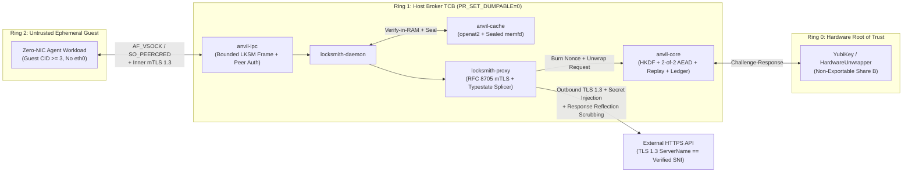

# Locksmith v1 Clean-Room Architecture & Security Specification (`SPEC.md`)

**Status:** Normative v1.0 Foundation  
**Target Platform:** Linux Host & MicroVM Topology (`x86_64-unknown-linux-gnu` / `aarch64-unknown-linux-gnu`), portable pure-Rust fallbacks for non-Linux development targets  
**Memory-Safety Posture:** `#![forbid(unsafe_code)]` workspace-wide

---

## 1. Privilege Ring Topology & Trust Boundaries

Locksmith partitions execution into three hardware- and kernel-enforced privilege rings so that an arbitrary-code-execution or prompt-injection compromise inside an autonomous agent workload (Ring 2) **cannot extract, replay, or misdirect long-lived credentials**.



### 1.1 Ring 0 — Hardware Unwrap Authority
- Holds **Share B** (`hw_share: Zeroizing<[u8; 32]>`) inside a hardware security token (YubiKey PIV/HMAC-chalresp or PKCS#11 token) accessed exclusively via the `anvil_core::unwrap::HardwareUnwrapper` trait.
- Never receives plaintext credentials; participates solely in deterministic challenge-response derivation bound to the sealed envelope salt and AAD digest.
- Software emulation (`SoftwareTestHsm`) is compiled **strictly** under `#[cfg(any(test, feature = "test-hsm"))]` and is absent from production release binaries.

### 1.2 Ring 1 — Host Credential Broker (`locksmith-daemon` + `locksmith-proxy`)
- Executes on the trusted Linux host (or Stage 2 read-only container with `--read-only --cap-drop=ALL --security-opt=no-new-privileges` and `0555` `root:root` binaries in `/usr/local/bin`).
- Immediately invokes `PR_SET_DUMPABLE(0)` (`rustix::process::set_dumpable_behavior`) at process initialization to forbid non-root `ptrace` attachment and kernel core dumps.
- Holds **Share A** (`host_share: Zeroizing<[u8; 32]>`) in zeroizable memory and encrypted AEAD secret envelopes on read-only storage.
- Exposes a bounded binary control plane (`anvil-ipc`) and an mTLS 1.3 egress proxy (`locksmith-proxy`) over `AF_VSOCK` (host `CID = 2`) or `SO_PEERCRED`-verified Unix domain sockets.

### 1.3 Ring 2 — Zero-NIC Ephemeral Agent Guest
- Executes inside an isolated microVM (or unprivileged sandboxed namespace in integration harnesses) with **zero IP routing interfaces** (no `eth0`, no raw sockets, no arbitrary DNS egress).
- Communicates with Ring 1 exclusively over `AF_VSOCK` using a statically assigned `guest_cid >= 3` registered in Ring 1's peer allowlist.
- Possesses an ephemeral workload X.509 client certificate for RFC 8705 mTLS binding, single-use request nonces, and zero raw upstream API credentials.

---

## 2. Cryptographic Architecture & Domain Separation (`anvil-core`)

All cryptographic operations use `aws-lc-rs = "1.18"` and `blake3 = "1.5"`. All secret buffers wrap `zeroize::Zeroizing`.

### 2.1 Canonical Length-Prefixed HKDF-SHA256 (`anvil_core::kdf`)

To defeat tuple-concatenation ambiguity (`["admin", "read"]` vs. `["admi", "nread"]` and `["a", ""]` vs. `["", "a"]`), every HKDF-SHA256 expansion constructs `info` via an injective, length-prefixed binary framing:

```text
+--------------------+--------------------+----------------------+
| proto_len: u16_be  | proto_tag: 12B     | count: u16_be        |
| 0x00 0x0C          | "LOCKSMITH-V1"     | N (num components)   |
+--------------------+--------------------+----------------------+
| comp_0_len: u16_be | comp_0_bytes       | comp_1_len: u16_be   | ...
+--------------------+--------------------+----------------------+
```

**Normative Rules:**
1. Protocol tag constant: `PROTOCOL_VERSION_TAG = b"LOCKSMITH-V1"` (`12` bytes).
2. Component count `N` MUST satisfy `N <= u16::MAX as usize` (`65,535`).
3. Every component slice `c_i` MUST satisfy `c_i.len() <= u16::MAX as usize` (`65,535` bytes); any violation returns `Err(CryptoError::ContextComponentTooLarge)` prior to key derivation.
4. Extraction uses `aws_lc_rs::hkdf::Salt::new(HKDF_SHA256, salt)` over the input keying material (`ikm`), expanding into `Zeroizing<[u8; 32]>`.

### 2.2 Normative HKDF Domain-Separation Registry

The first context component `c_0` MUST be one of the following disjoint ASCII domain tags:

| Domain Tag (`c_0`) | Purpose | Subsequent Context Components `(c_1, c_2, ...)` |
| :--- | :--- | :--- |
| `"unwrap-kek-v1"` | 2-of-2 AEAD Key-Encryption Key | `(secret_id.as_bytes(), &policy_hash[..32], &guest_cid.to_be_bytes()[..4])` |
| `"unwrap-hw-chal-v1"` | Ring 0 Hardware Token Challenge | `(&envelope_salt[..32], &aad_digest[..32])` |
| `"cache-mac-v1"` | `anvil-cache` Keyed `BLAKE3` MAC Key | `(cache_namespace.as_bytes(),)` |
| `"ipc-attest-v1"` | `anvil-ipc` Command Envelope Key | `(&guest_cid.to_be_bytes()[..4],)` |

### 2.3 2-of-2 AEAD Secret Unwrapping (`anvil_core::unwrap`)

Secrets at rest are stored inside `SealedSecretEnvelope`:

```text
SealedSecretEnvelope {
    version: u8,              // Must equal 1
    hkdf_salt: [u8; 32],      // Per-envelope random HKDF salt
    nonce: [u8; 12],          // 96-bit ChaCha20-Poly1305 unique nonce
    ciphertext_and_tag: Vec<u8>, // Ciphertext || 16-byte Poly1305 tag (<= 64 KiB)
}
```

**Canonical AAD Construction (`UnwrapAad`):**
Every seal and open operation binds `ChaCha20-Poly1305` Additional Authenticated Data (`aws_lc_rs::aead::Aad`) to:
- `secret_id: &str` (`1..=256` ASCII graphic bytes)
- `policy_hash: [u8; 32]` (`BLAKE3` digest of the authorizing egress policy rule)
- `guest_cid: u32` (Authorized Ring 2 workload CID)

Encoded using the exact length-prefixed format:
`[u16_be(12) || "LOCKSMITH-V1" || u16_be(11) || "aead-aad-v1" || u16_be(secret_id.len()) || secret_id || u16_be(32) || policy_hash || u16_be(4) || guest_cid_be]`.

**Unwrap Procedure:**
1. Compute `aad_bytes = aad.encode_canonical()?` and `aad_digest = SHA256(aad_bytes)`.
2. Derive deterministic hardware challenge via `derive_subkey(&envelope.hkdf_salt, b"LOCKSMITH-CHALLENGE", &[b"unwrap-hw-chal-v1", &envelope.hkdf_salt, &aad_digest])`.
3. Invoke `hw_share = hardware.derive_hardware_share(&challenge)?` (`Zeroizing<[u8; 32]>`).
4. Concatenate `combined_ikm: Zeroizing<[u8; 64]> = host_share (32B) || hw_share (32B)`.
5. Derive `kek: Zeroizing<[u8; 32]> = derive_subkey(&envelope.hkdf_salt, &combined_ikm, &[b"unwrap-kek-v1", secret_id, &policy_hash, &guest_cid_be])?`.
6. Open `ciphertext_and_tag` using `aws_lc_rs::aead::LessSafeKey::new(UnboundKey::new(&CHACHA20_POLY1305, &*kek)?)` with `Nonce::try_assume_unique_for_key(&envelope.nonce)` and `Aad::from(&aad_bytes)`.
7. On any tag, ciphertext, nonce, share, or AAD mismatch, zeroize intermediate buffers and return `Err(CryptoError::AuthenticationFailed)` with zero partial plaintext returned.
8. Wrap plaintext in `SecretBytes(Zeroizing<Vec<u8>>)`, whose `fmt::Debug` and `fmt::Display` unconditionally emit `"SecretBytes([REDACTED])"`.
9. Production compilation enforces `#[cfg(all(feature = "prod-strict", feature = "test-hsm"))] compile_error!(...)` so `SoftwareTestHsm` can never be linked into production binaries.

### 2.4 Concurrency-Safe Single-Use Nonce Filter (`anvil_core::replay`)

- Each privileged operation supplies `(nonce: [u8; 32], timestamp_ms: u64)` evaluated against a monotonically non-decreasing clock (`ReplayFilter::monotonic_now_ms()` anchored to `std::time::Instant` so NTP backward steps cannot replay nonces).
- **Freshness Check:** Given monotonic `effective_now_ms`, reject `timestamp_ms` with `ReplayError::TimestampExpired` if `effective_now_ms.saturating_sub(timestamp_ms) > skew_window_ms` or `ReplayError::TimestampInFuture` if `timestamp_ms.saturating_sub(effective_now_ms) > skew_window_ms` (default `skew_window_ms = 30_000` ms = `+-30s`).
- **Atomic Burn & Future-Pinned Eviction Immunity:**
  1. Acquire internal mutex lock over `(HashMap<[u8; 32], u64>, VecDeque<([u8; 32], u64)>, last_now_ms)`.
  2. Clamp `effective_now_ms = now_ms.max(last_now_ms)`.
  3. Purge front queue entries whose monotonic expiry (`front_expires_at = recorded_now_ms + 2 * skew_window_ms`, i.e., full `60s` validity span) satisfies `front_expires_at <= effective_now_ms`, removing `front_nonce` from `burned` **only** when `burned.get(&front_nonce) == Some(&front_expires_at)`.
  4. If `nonce` is already present in the live map, immediately return `Err(ReplayError::NonceAlreadyBurned)`.
  5. If either `burned.len() >= max_entries` or `order.len() >= max_entries`, fail closed with `Err(ReplayError::CapacityExceeded)`—**never** evict an unexpired nonce.
  6. Insert `expires_at_ms = effective_now_ms + 2 * skew_window_ms` into both `burned` and `order` and return `Ok(())`.

### 2.5 Append-Only `BLAKE3` Audit Ledger (`anvil_core::ledger`)

- Genesis anchor: `GENESIS_PREV_HASH = [0u8; 32]`.
- Each `LedgerEvent` (`sequence: u64`, `timestamp_ms: u64`, `kind: String`, `actor: String`, `summary: String`) serializes deterministically into `canonical_event_bytes`:
  `[b"LOCKSMITH-LEDGER-V1" || sequence_be: 8B || timestamp_ms_be: 8B || u16_be(kind.len()) || kind || u16_be(actor.len()) || actor || u16_be(summary.len()) || summary]`.
- Chaining equation (streamed directly into `blake3::Hasher` without intermediate buffer concatenation):
  `entry_hash = blake3::hash(prev_hash || canonical_event_bytes)`.
- Retains a bounded in-memory sliding window (`VecDeque<LedgerEntry>`, default `4,096` entries) anchored to `retained_anchor_prev_hash` while maintaining monotonic `total_committed` sequence continuity so unauthenticated event floods cannot exhaust Ring 1 RAM.
- `AuditLedger::verify_slice(expected_prev_hash: &[u8; 32], entries: &[LedgerEntry])` verifies contiguous sequence progression, `prev_hash` linkage, and constant-time equality of recomputed `entry_hash` across any contiguous slice of entries.

---

## 3. Untrusted Cache Verification & TOCTOU-Immune Sealing (`anvil-cache`)

Ring 1 treats disk-backed cache directories as **untrusted, potentially hostile storage** shared across restarts or mounted volumes.

### 3.1 Content Addressing & Keyed `BLAKE3` Binding (`store.rs`)

- Every cache blob is addressed on disk by its hex-encoded `BLAKE3` content root (`<64-hex>.blob`), paired with a compact binary header/manifest `<64-hex-key-id>.entry`, read and written exclusively via confined `openat2` (`BENEATH | NO_SYMLINKS | NO_XDEV`) + atomic `0600` temp-file `fsync` + `renameat` relative to an `O_NOFOLLOW | O_DIRECTORY` root `OwnedFd`.
- Before any cache hit is returned, `CacheStore` computes a keyed `BLAKE3` MAC (`blake3::keyed_hash(&mac_key, &canonical_record)`) over:
  1. Domain prefix `b"LOCKSMITH-CACHE-MAC-V1"`
  2. `u16_be(logical_cache_key.len()) || logical_cache_key.as_bytes()`
  3. `schema_version: u32` (big-endian)
  4. `content_len: u64` (big-endian)
  5. `blake3_root: [u8; 32]` (recomputed over the in-RAM sealed copy, never trusted from disk metadata!)
  6. Count and length-prefixed sanitized `(meta_key, meta_value)` pairs sorted lexicographically.
- Comparing the recomputed MAC uses `aws_lc_rs::constant_time::verify_slices_are_equal`. Swapping two validly MAC'd files under each other's logical keys deterministically fails with `CacheError::IntegrityMismatch`.

### 3.2 Path Confined Disk Access (`openat2`) & Kernel `memfd` Sealing (`seal.rs`)

```mermaid
stateDiagram-v2
    [*] --> OpenConfined: openat2(root_fd, rel_path, BENEATH | NO_SYMLINKS | NO_XDEV)
    OpenConfined --> CopyToAnonRam: memfd_create(ALLOW_SEALING | CLOEXEC) + bounded stream copy
    CopyToAnonRam --> VerifyInRam: Recompute BLAKE3 digest + Keyed BLAKE3 MAC over RAM bytes
    VerifyInRam --> ApplyKernelSeals: fcntl_add_seals(WRITE | SHRINK | GROW | SEAL)
    ApplyKernelSeals --> ConfirmSeals: fcntl_get_seals() contains all 4 seals
    ConfirmSeals --> VerifiedReadOnlyBlob: Safe immutable handle returned to caller
    OpenConfined --> Rejected: ELOOP / EXDEV -> CacheError::PathViolation
    VerifyInRam --> Rejected: Digest/MAC mismatch -> Drop unsealed memfd
```

1. **Pre-Open Path Validator & `openat2`:**
   - Rejects empty paths, leading `/`, NUL bytes, `.` or `..` path segments, backslashes, or non-ASCII-alphanumeric-safe cache filenames before touching the VFS.
   - On Linux (`#[cfg(target_os = "linux")]`), opens relative paths exclusively through `rustix::fs::openat2` anchored at the cache root directory `OwnedFd` with `OFlags::RDONLY | OFlags::CLOEXEC | OFlags::NOFOLLOW` and `ResolveFlags::BENEATH | ResolveFlags::NO_SYMLINKS | ResolveFlags::NO_XDEV`. Any symlink (`ELOOP`) or mount-crossing (`EXDEV`) maps to `CacheError::PathViolation`.
2. **Verify-in-RAM & Kernel File Sealing:**
   - Allocates an anonymous RAM file via `rustix::fs::memfd_create(c"locksmith-cache-blob", MemfdFlags::ALLOW_SEALING | MemfdFlags::CLOEXEC)`.
   - Streams at most `max_blob_bytes` from the untrusted disk fd into the `memfd`, computing `blake3::Hasher` in-flight. Disk fd is closed immediately.
   - Applies kernel seals `SealFlags::WRITE | SealFlags::SHRINK | SealFlags::GROW | SealFlags::SEAL` via `rustix::fs::fcntl_add_seals` and verifies via `fcntl_get_seals` **before** verifying final metadata/MAC and constructing `VerifiedReadOnlyBlob`.
   - Once sealed, mutating or truncating the original disk file cannot alter the `memfd`, and any attempt by any process with the `memfd` descriptor to `write()` or `ftruncate()` fails in the kernel with `EPERM`.
   - On Linux, `SealPolicy::RequireKernelMemfd` (default) **fails closed** (`CacheError::SealFailure`) if `memfd_create` or kernel sealing fails unless an explicit test-only `SealPolicy::AllowUnsealedFallback` policy is passed. Non-Linux development targets use a private verified `Arc<[u8]>` in process RAM.

### 3.3 Metadata & Prompt-Injection Sanitizer (`sanitize.rs`)

All cached metadata keys and values pass through `sanitize_metadata_str()` which **deterministically rejects** (`SanitizeError`):
- ASCII C0 control characters (`U+0000..=U+001F`) and `DEL` (`U+007F`)
- C1 control characters (`U+0080..=U+009F`), including 8-bit CSI (`U+009B`) and OSC (`U+009D`)
- ANSI escape sequences (`ESC [` CSI, `ESC ]` OSC, or any `U+001B` byte)
- Invisible Unicode Tag block characters (`U+E0000..=U+E007F`) used in LLM prompt-smuggling attacks
- Bidirectional text override and isolate controls (`U+202A..=U+202E`, `U+2066..=U+2069`, `U+200E`, `U+200F`, `U+061C`)
- Zero-width format characters (`U+200B..=U+200D`, `U+FEFF`)

---

## 4. Authenticated IPC Wire Protocol (`anvil-ipc`)

### 4.1 Bounded Binary Frame Layout (`frame.rs`)

Every message on `AF_VSOCK` or `AF_UNIX` uses a fixed 10-byte big-endian header followed by `payload_len` bytes:

```text
 0                   1                   2                   3
 0 1 2 3 4 5 6 7 8 9 0 1 2 3 4 5 6 7 8 9 0 1 2 3 4 5 6 7 8 9 0 1
+-+-+-+-+-+-+-+-+-+-+-+-+-+-+-+-+-+-+-+-+-+-+-+-+-+-+-+-+-+-+-+-+
|      'L'      |      'K'      |      'S'      |      'M'      |  Bytes 0..4: Magic (0x4C4B534D)
+-+-+-+-+-+-+-+-+-+-+-+-+-+-+-+-+-+-+-+-+-+-+-+-+-+-+-+-+-+-+-+-+
|  Version (1)  |   MsgType     |      PayloadLength (HI)       |  Byte 4: Ver, Byte 5: Type
+-+-+-+-+-+-+-+-+-+-+-+-+-+-+-+-+-+-+-+-+-+-+-+-+-+-+-+-+-+-+-+-+
|      PayloadLength (LO)       |         Payload ...           |  Bytes 6..10: u32_be Length
+-+-+-+-+-+-+-+-+-+-+-+-+-+-+-+-+-+-+-+-+-+-+-+-+-+-+-+-+-+-+-+-+
```

- `MAX_FRAME_BYTES = 65_536` (`64 KiB`).
- **Zero-Allocation Frame-Bomb Guard:** Frame reader reads strictly `[u8; 10]` on the stack first. If `magic != *b"LKSM"`, `version != 1`, `msg_type` is unknown, or `payload_len > 65_536`, the reader **immediately returns `Err(IpcError::FrameTooLarge)` (or protocol error) and drops the stream without allocating any heap buffer**.
- **Read Deadline Enforcement:** Both header and payload reads execute inside `tokio::time::timeout(frame_read_deadline, ...)` to defeat Slowloris byte-drip resource exhaustion.

### 4.2 Kernel-Verified Peer Transport (`transport.rs`)

Connections are authenticated at `accept()` time **before** reading a single wire byte:
1. **Linux `AF_VSOCK` (`#[cfg(target_os = "linux")]`):** Wraps `tokio_vsock::VsockListener`; extracts peer `VsockAddr::cid()`, rejects reserved hypervisor/loopback/host/wildcard CIDs (`0..=2` and `VMADDR_CID_ANY` `u32::MAX`), and checks `allowlist.contains_cid(peer_cid)`. Unauthorized CIDs are closed immediately (`IpcError::UnauthorizedPeer`).
2. **Unix Domain Socket (`AF_UNIX`):** `UnixIpcListener::bind` creates and verifies an owner-only `0600` socket file (`is_socket() && mode == 0600`) prior to accepting connections; on Linux extracts kernel `ucred` (`uid`, `gid`, `pid`) via `rustix::net::sockopt::socket_peercred` and checks `allowlist.contains_uid(peer_uid)` mapped strictly to valid guest CIDs (`3..=u32::MAX - 1`). Unauthorized UIDs are closed immediately (`IpcError::UnauthorizedPeer`).

### 4.3 Attested Command Envelope (`envelope.rs`)

Privileged control-plane frames carry `AttestedCommandEnvelope`:
- `guest_cid: u32` (must equal transport-authenticated peer CID in `3..=u32::MAX - 1`)
- `sequence_no: u64` (strictly monotonic; `u64::MAX` fails closed with `IpcError::SequenceExhausted` to prevent watermark wraparound)
- `timestamp_ms: u64`
- `nonce: [u8; 32]`
- `command_digest: [u8; 32]` (`BLAKE3` digest of `command_payload`)
- `hardware_signature: [u8; 32]` (keyed-`BLAKE3` tag under `ipc-attest-v1` subkey over canonical envelope fields)

Verified in constant time and burned in `ReplayFilter` prior to invoking any command handler.

---

## 5. Typestate Egress Proxy & Confused-Deputy Firewall (`locksmith-proxy`)

### 5.1 Unforgeable Single-Use `ApprovedEgressTicket` (`ticket.rs`)

```rust
pub struct ApprovedEgressTicket {
    // Strictly private fields; !Clone, !Copy, no Serialize/Deserialize
    verified_sni: String,
    verified_port: u16,
    canonical_request_head: Vec<u8>,
    request_body: Vec<u8>,
    injection_header_name: String,
    injection_header_value: Zeroizing<String>,
    raw_secret: SecretBytes,
}
```

- `ApprovedEgressTicket` has **no public constructors**, **no `Clone`/`Copy`**, and **no `Deserialize`**.
- Only `PolicyEngine::authorize_egress()` inside `crates/locksmith-proxy/src/policy.rs` can construct it via `pub(crate) fn mint(...)`.
- `splice_outbound_request(ticket: ApprovedEgressTicket, ...)` consumes `ticket` **by value**, making double-splicing a compile-time error in Rust.

### 5.2 Five-Stage Policy & HTTP Canonicalization Gate (`policy.rs`)

`PolicyEngine::authorize_egress()` executes five sequential fail-closed checks:

1. **RFC 8705 mTLS Certificate Thumbprint & Transport CID Binding:**
   - Enforces `proxy_req.guest_cid == authenticated_guest_cid`, computes `SHA256(peer_leaf_cert_der)`, and verifies constant-time equality against the registered `WorkloadIdentity::cert_thumbprint_sha256` for the claimed workload.
2. **Static Upstream Tuple Allowlist & Segment-Boundary Matching:**
   - Matches `(sni_hostname, port, http_method, path_and_query)` against workload-scoped `EgressRule`s using segment-boundary prefix checks (`/v1/messages` matches `/v1/messages` and `/v1/messages/...`, never `/v1/messages_admin`).
   - Iteratively percent-decodes (up to 8 passes) to reject hidden `.`/`..` dot segments, double slashes (`//`), path parameters (`;`), fragments (`#`), malformed `%` escapes, backslashes, NULs, or non-origin-form request targets.
3. **Strict RFC 9110 / RFC 9112 HTTP/1.1 Request Canonicalization:**
   - Requires exact `HTTP/1.1` request line without CR/LF/NUL injection.
   - Validates every header name is non-empty RFC 9110 `tchar` and every header value contains **zero** `\r`, `\n`, `\0`, or C0 control bytes (except HTAB `0x09`).
   - Enforces **strictly one `Host` header** whose hostname matches `sni_hostname` byte-for-byte (case-insensitive ASCII normalized to lowercase; optional `:port` permitted only if matching `verified_port`). Missing, duplicate, or mismatched `Host` headers fail with `PolicyError::HostSniMismatch` **before any upstream socket is dialed**.
   - Rejects requests carrying `Transfer-Encoding` alongside `Content-Length`, any unsupported `Transfer-Encoding`, duplicate `Content-Length` headers, or body length != `Content-Length`.
   - Strips or rejects guest-supplied `Authorization`/`Proxy-Authorization` headers per `guest_auth_mode` (bound into `EgressRule::policy_hash` with `u64` length prefixes), strips guest `Accept-Encoding`/`TE`/`Range`, injects `Accept-Encoding: identity`, and forces `Connection: close`.
4. **Atomic Nonce Burn:**
   - Burns `(request_nonce, timestamp_ms)` in `anvil_core::replay::ReplayFilter`.
5. **2-of-2 Hardware-Attested Credential Unwrap & Entropy Floor:**
   - Unwraps `SecretBytes` via `anvil_core::unwrap::SecretUnwrapper` with `UnwrapAad { secret_id, policy_hash, guest_cid }`, enforces a minimum 8-byte secret length (`PolicyError::SecretTooShort`), and formats the outbound header inside `Zeroizing<String>`.

### 5.3 TLS 1.3 Splicing, SSRF Guard & Reflection Scrubber (`splicer.rs`)

1. Resolves `(verified_sni, verified_port)` via `UpstreamResolver`, rejecting loopback, RFC 1918 private, link-local/metadata (`169.254.0.0/16`), CGNAT (`100.64.0.0/10`), multicast, unspecified, and IPv4-mapped non-global IPv6 addresses (`SystemDnsResolver`), and constructs `rustls::pki_types::ServerName::try_from(ticket.verified_sni())`.
2. Negotiates outbound TLS 1.3 (`rustls` with `tls12` disabled at compile time and `aws_lc_rs` crypto provider) and writes the canonical request head + injected secret header + body directly into the encrypted TLS stream. Zeroizing secret header buffers are dropped immediately after `flush()`.
3. Reads at most `MAX_UPSTREAM_RESPONSE_BYTES` (`16 MiB`), rejects non-`identity` `Content-Encoding`, and passes status reason, header values, and body bytes through a single-pass `scrub_secret_reflections()` scanner:
   - Replaces every raw byte occurrence, uppercase/lowercase percent-encoded form, and `0`, `1`, and `2 mod 3` byte-offset standard/URL-safe Base64 encoding (including boundary nibbles and `=` padding) of `raw_secret` with `b"[REDACTED_BY_LOCKSMITH]"` without self-matching.
   - Recomputes `Content-Length` (re-framing `Transfer-Encoding: chunked` into exact `Content-Length`) so Ring 2 receives a well-formed, completely redacted HTTP/1.1 response.

---

## 6. Adversarial Threat Matrix

| Threat ID | Attack Vector | Defeating Architectural Invariant | Verification Artifact |
| :--- | :--- | :--- | :--- |
| **T-01** | **HKDF Tuple Concatenation Collision** (`["admin","read"]` == `["admi","nread"]`) | `[u16_be_len \|\| bytes]` canonical prefix-free framing under `"LOCKSMITH-V1"` | `crates/anvil-core/tests/redteam_crypto.rs` |
| **T-02** | **Single-Share Compromise or Cross-Guest Ciphertext Transplant** | 2-of-2 HKDF (`host_share \|\| hw_share`) + ChaCha20-Poly1305 AAD binding `(secret_id, policy_hash, guest_cid)` | `crates/anvil-core/tests/redteam_crypto.rs` |
| **T-03** | **Concurrent Nonce Double-Spend Race** | Linearizable mutex-guarded check-and-burn + `+-30s` skew window + fail-closed capacity limit | `crates/anvil-core/tests/redteam_crypto.rs` (64-task `Barrier`) |
| **T-04** | **Secret Leakage via Logs, Panics, Core Dumps, or `Debug`** | `SecretBytes` redacted `Debug`/`Display`, `Zeroizing` drop, `PR_SET_DUMPABLE(0)`, `unwrap_used = "deny"` | `crates/anvil-core/tests/redteam_crypto.rs` + `locksmith-daemon` |
| **T-05** | **Disk Cache Post-Verification Mutation (TOCTOU)** | Copy into anonymous `memfd`, verify `BLAKE3` + keyed MAC in RAM, seal with `F_SEAL_WRITE\|SHRINK\|GROW\|SEAL` | `crates/anvil-cache/tests/redteam_cache.rs` |
| **T-06** | **Cache Key-Substitution / Blob Swapping** | Keyed `BLAKE3` MAC binds `logical_cache_key`, `schema_version`, `content_len`, and `blake3_root` | `crates/anvil-cache/tests/redteam_cache.rs` |
| **T-07** | **Cache Symlink Escape & `../` Directory Traversal** | Pre-open segment validator + Linux `openat2(BENEATH \| NO_SYMLINKS \| NO_XDEV)` | `crates/anvil-cache/tests/redteam_cache.rs` |
| **T-08** | **Prompt-Injection / Terminal Escape Smuggling in Cache Metadata** | Deterministic rejection of C0/C1, ANSI CSI/OSC, Unicode Tags (`U+E0000..=U+E007F`), and Bidi overrides | `crates/anvil-cache/tests/redteam_cache.rs` |
| **T-09** | **4 GiB IPC Frame-Bomb Heap Exhaustion (OOM DoS)** | 10-byte stack header check enforcing `payload_len <= 65_536` **before** buffer allocation | `crates/anvil-ipc/tests/redteam_ipc.rs` |
| **T-10** | **Slowloris Byte-Drip Descriptor Exhaustion** | Mandatory per-frame `tokio::time::timeout` deadline tearing down stalled streams | `crates/anvil-ipc/tests/redteam_ipc.rs` |
| **T-11** | **Unauthorized Local Process or Rogue MicroVM Connection** | Pre-read kernel `AF_VSOCK` peer CID and `AF_UNIX` `SO_PEERCRED` UID allowlist gate | `crates/anvil-ipc/tests/redteam_ipc.rs` |
| **T-12** | **SNI Domain Fronting / `Host` Header Desync** | Single `Host` header byte-for-byte equality with `ApprovedEgressTicket::verified_sni()` prior to socket dial | `crates/locksmith-proxy/tests/redteam_proxy.rs` |
| **T-13** | **HTTP Request Smuggling & CRLF/NUL Header Injection** | Strict RFC 9110/9112 parser rejecting `\r`/`\n`/`\0` and conflicting `Content-Length` + `Transfer-Encoding` | `crates/locksmith-proxy/tests/redteam_proxy.rs` |
| **T-14** | **Stolen Workload Request / mTLS Impersonation** | RFC 8705 SHA-256 leaf certificate thumbprint verification against workload policy rule | `crates/locksmith-proxy/tests/redteam_proxy.rs` |
| **T-15** | **Upstream Diagnostic / 502 Error Secret Reflection** | Response header & body scrubber replacing raw/encoded secret bytes with `[REDACTED_BY_LOCKSMITH]` | `crates/locksmith-proxy/tests/redteam_proxy.rs` |
| **T-16** | **Container / Host Provisioning Supply-Chain & `argv` Token Leak** | SHA-256 pinned base images, Sigstore `cosign` OIDC verification, `0555` `/usr/local/bin`, `op read` stdin piping in `infra/forge` | `infra/Dockerfile`, `.github/workflows/ci-and-sign.yml`, `infra/forge` |

---

## 7. Deployment, Container & Ephemeral Host Invariants (`locksmith-daemon` & `infra/`)

1. **Daemon Startup Self-Test (`locksmith-daemon verify-self`):** Executes deterministic cryptographic KATs (HKDF tuple separation, 2-of-2 AEAD seal/open + tamper rejection, replay burn, metadata sanitizer, and HTTP canonicalizer) before returning `0`.
2. **Immutable Runtime Filesystem:** Container images install binaries as `0555` `root:root` in `/usr/local/bin/locksmith-daemon`, execute as non-root UID `65532`, drop all Linux capabilities (`--cap-drop=ALL`), enforce `--security-opt=no-new-privileges`, mount rootfs `--read-only`, and contain zero `node`/`npm` or `~/.local` paths.
3. **Keyless OIDC Provenance & `forge` Controller:** Every published container image is signed via Sigstore `cosign` keyless GitHub Actions OIDC identity and verified on the ephemeral Vultr host by `infra/forge` prior to `docker run`, with `forge down` destroying the cloud instance cleanly (`$0.00/hr` idle cost).
